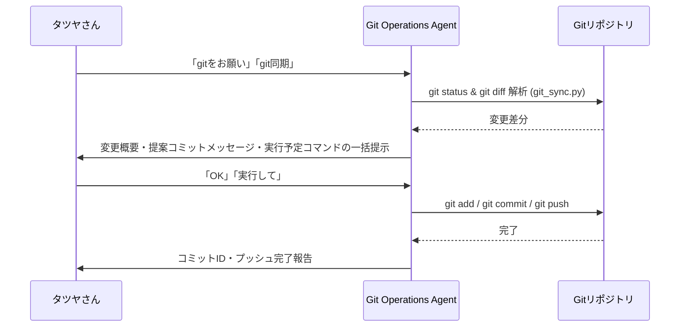

# 🚀 Git Sync & Operations Agent (Git運用・リリースエージェント)

## 概要
本エージェント（スキル）は、Git操作に伴う細かい確認ステップを自動化し、変更ステータスと差分を瞬時に整理して、明快な日本語コミットメッセージとともに「一括承認依頼」を提示・実行します。

## 動作フロー



## 実行支援コマンド
```bash
python3 "90_System/91_Scripts/git_sync.py"
```

## コミットメッセージ規約（Conventional Commits 日本語形式）
- `feat`: 新機能や新規エージェント/スキルの追加
- `fix`: バグ修正、リンク切れ修正、エラー解消
- `docs`: ドキュメント作成・更新、ルール改定
- `refactor`: リファクタリング、構成整理
- `test`: テストコードの追加・修正
- `chore`: 設定ファイル更新、細かなメンテナンスタスク
