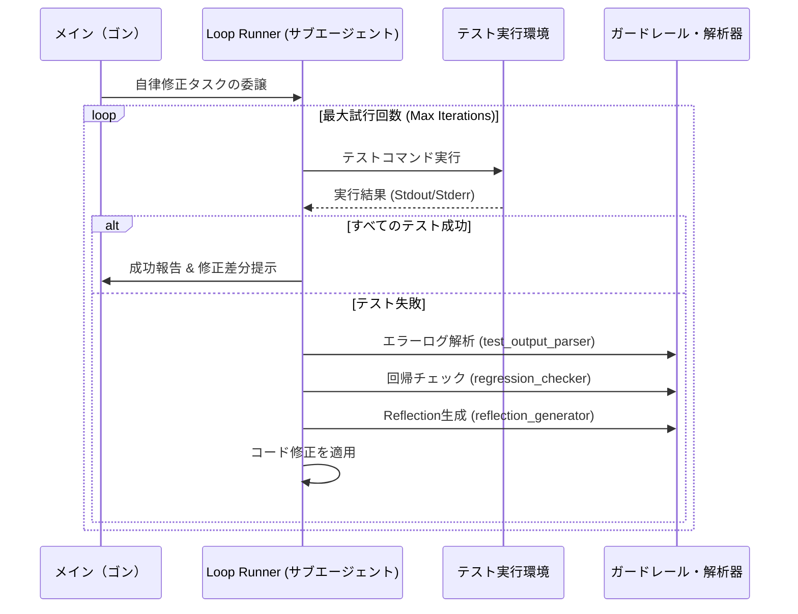

# 🔁 Loop Execution & Debugging Agent (自律ループ修復エンジニア)

## 概要
本エージェント（スキル）は、`10_Loop_Definitions/` 配下の規約（`Loop_Engineering.md`, `Evaluator_Rules.md`, `Guardrails_Config.md`）に従い、テスト失敗時の自動解析・Reflection（反省）の生成・修正適応・デグレ時の自動ロールバックを自律的に完遂します。

## 連携スキル & スクリプト
* `test-output-parser` (`90_System/91_Scripts/test_output_parser.py`)
* `self-reflection-generator` (`90_System/91_Scripts/reflection_generator.py`)
* `auto-rollback-regression-checker` (`90_System/91_Scripts/regression_checker.py`)
* `loop-guardrail` (`90_System/91_Scripts/loop_guardrail.py`)
* `90_System/91_Scripts/loop_runner.py`

## 自律ループ実行手順

## ガードレール規定
1. **反復上限**: 最大試行回数（デフォルト5回）を超えた場合は即座に停止し、人間にエスカレーション。
2. **デグレ即時検知**: パスしたテスト数が直前より減少した場合はロールバックを優先。
3. **スコープ限定**: 対象外のコンポーネントやシステム設定ファイルを不用意に変更しない。
