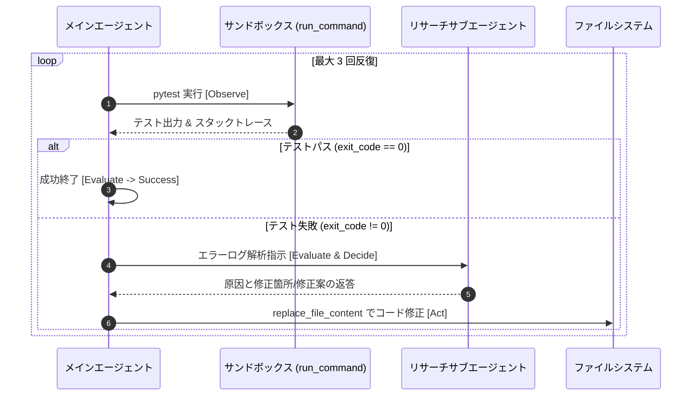

# 自動バグ修正＆テスト検証ループ定義書 (Auto BugFix Loop Definition)

本ドキュメントは、Google Antigravity 環境下で動作する「自動バグ修正＆テスト検証ループ」の具体仕様を定義したファイルです。

---

## 1. 基本概要

- **ループ名**: 自動バグ修正＆テスト検証ループ
- **識別子 (ID)**: `LOOP-BUGFIX-01`
- **目的・目標**: テストコード（例: `pytest`）が全件パス（`exit_code == 0`）するまで、コード修正と検証を自動反復する。
- **適用対象**: Pythonソースコードおよびユニットテストスイート。

---

## 2. 実行シーケンスとOEDAフェーズ

### 2.1 観察フェーズ (Observe)
- **コマンド**: `pytest --tb=short` (サンドボックス環境で実行)
- **収集データ**: 標準出力、標準エラー出力、終了コード (`exit_code`)、失敗したテストケース名、スタックトレース。

### 2.2 評価フェーズ (Evaluate)
- **判定条件**:
  - `exit_code == 0`: **成功 (SUCCESS)** -> ループ脱出。
  - `exit_code != 0`: **失敗 (FAILURE)** -> 次のイテレーションへ。
- **決定論的評価優先ルール**: 修正提案前に必ず `pytest` の決定論的実行結果を評価材料とする。

### 2.3 意思決定フェーズ (Decide)
- **サブエージェント活用**:
  - `invoke_subagent` (TypeName: `research`, Role: `Bug Analyzer`) を呼び出し、エラーログとソースコードのコンテキストを渡して原因分析を行わせる。
- **履歴参照ルール**:
  - 過去のイテレーションで試みた修正案とエラーログの履歴を保持し、同一アプローチの重複を禁止する。

### 2.4 実行フェーズ (Act)
- **操作ツール**: `replace_file_content` または `multi_replace_file_content`
- **制約**:
  - 該当バグの修正に必要な最小限の行数変更にとどめる。
  - 変更理由（`Description`）にイテレーション番号と修正根拠を明記する。

---

## 3. ガードレール & 安全規定

| パラメータ | 設定値 | 違反時の処置 |
| :--- | :--- | :--- |
| **Max Iterations** | 3 回 | ループを停止し、詳細ログを添えてユーザーに指示を仰ぐ |
| **同一エラー連続発生** | 2 回 | アプローチ変更フラグを立て、サブエージェントへ別の修正案を要請 |
| **回帰テスト検証** | 必須 | 修正対象以外のテストケースが失敗した場合は直ちに修正を取り消す |
| **タイムアウト** | 180 秒 / 1イテレーション | サンドボックス処理をキャンセルし異常終了 |
