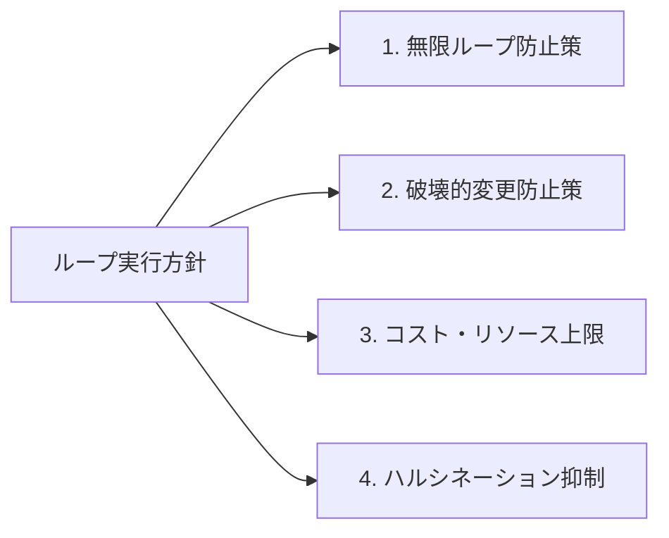

# ループガバナンス＆ガードレール規定書 (Guardrails Configuration)

本ドキュメントは、ループエンジニアリング実行時における暴走・リソース枯渇・品質低下を防ぐためのガードレール（安全装置）規定です。

---

## 1. アンチパターンと防衛策

---

## 2. ガードレール詳細規定

### 2.1 1. 無限ループ（堂々巡り）防止策
- **履歴追跡 (State History)**:
  - 過去 $N$ 回の修正差分（diff）および発生したエラーメッセージのハッシュ値を保持する。
- **同一エラー検知**:
  - 同一のエラーが **2回連続** で出力された場合、AIが同じ空回り修正を行っていると判断し、プロンプトに「直前と異なるアプローチをとること」を強制追加する。

### 2.2 2. 破壊的変更（回帰バグ）防止策
- **回帰テストの強制化**:
  - 修正した個別のテストケースだけでなく、全ユニットテストスイートを毎イテレーションで実行する。
- **ロールバックメカニズム**:
  - 修正適用後に既存のパスしていたテストが失敗した場合（デグレ）、該当の変更を自動破棄（`git checkout` または差分取り消し）し、1つ前の状態に戻す。

### 2.3 3. コスト・リソース上限制御
- **ハード上限値**:
  - **最大ループ回数 (`Max_Retries`)**: デフォルト **3 回**（最大 5 回）
  - **累積消費トークン上限 (`Max_Tokens`)**: 100,000 トークン
  - **1イテレーション制限時間**: 180 秒
- **超限時の振る舞い**:
  - 上限に達した時点で直ちにループを停止し、現在の進行状況・試行履歴・未解決のエラーログをまとめたレポートを作成してユーザーの確認を求める。

### 2.4 4. ハルシネーション・誤判定の抑止
- **決定論的結果の尊厳**:
  - AI自身の「修正できました」という自己宣言を信用せず、必ずターミナル/コマンド実行結果の `exit_code == 0` を確認するまでループ完了と認めない。

---

## 3. ガードレール評価チェックリスト

- [ ] `max_retries` パラメータが設定されているか
- [ ] エラー履歴の比較ロジックが組み込まれているか
- [ ] テスト全件実行の回帰チェックが有効になっているか
- [ ] 決定論的チェック（`exit_code`）が脱出条件に含まれているか
