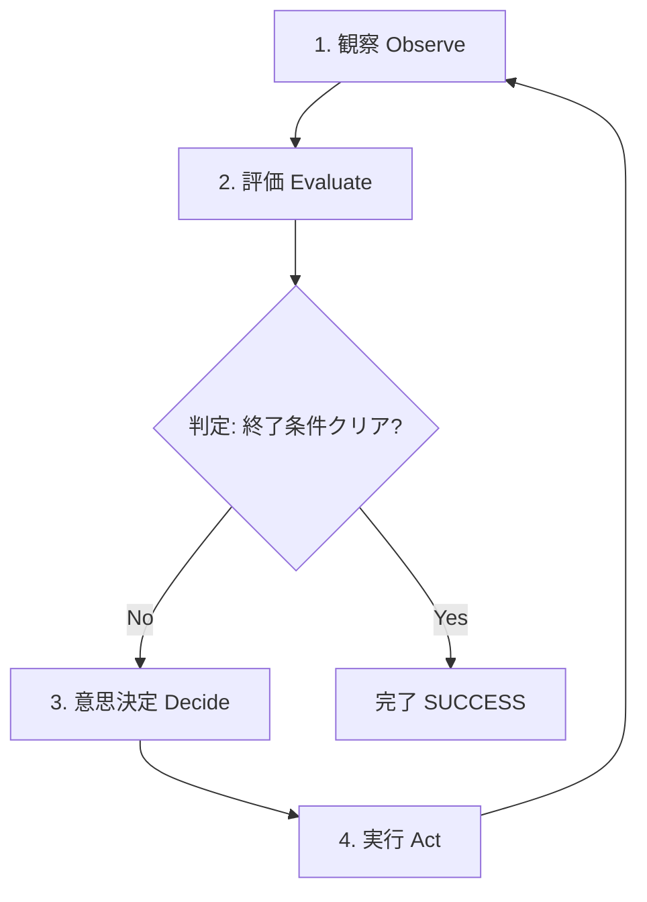

# ループ定義仕様書テンプレート (Loop Definition Template)

本ドキュメントは、新規の循環型改善ループ（ループエンジニアリング）を設計・導入する際に使用する標準テンプレートです。

---

## 1. 基本概要

- **ループ名**: [例: 自動コードリファクタリングループ]
- **識別子 (ID)**: `LOOP-XXX`
- **目的・目標**: [何を達成するためのループか]
- **適用対象**: [ソースコード、ドキュメント、データパイプラインなど]

---

## 2. ループ構造定義 (OEDA フェーズ)

### 2.1 観察フェーズ (Observe)
- **取得するデータ**: [テスト実行ログ、Linter出力、ビルドログ、ファイル内容など]
- **使用するツール/コマンド**: [例: `pytest`, `eslint`, `run_command`]

### 2.2 評価フェーズ (Evaluate)
- **決定論的評価 (Deterministic)**: [テスト全件成功 (exit_code == 0) など]
- **確率論的評価 (Probabilistic)**: [LLMレビューによるスコア >= 0.85 など]
- **成功判定条件**: [目標達成とみなす具体的なしきい値]

### 2.3 意思決定フェーズ (Decide)
- **使用コンテキスト**: [前回の実行ログ、失敗履歴、修正試行回数]
- **プロンプト/判断基準**: [どのように修正方針を決定するか。サブエージェント委任の有無]

### 2.4 実行フェーズ (Act)
- **実行するアクション**: [ファイルの差分更新 (`replace_file_content`), コマンド実行]
- **変更範囲制限**: [影響範囲の指定]

---

## 3. ガードレール & 終了条件

- **最大試行回数 (Max Retries)**: [例: 3回]
- **タイムアウト/予算上限**: [例: 300秒 / 50,000 トークン]
- **異常終了条件**: [同一エラーの2回連続発生、回帰テスト失敗]
- **エスカレーション**: [上限超過時に人間に確認を求めるフロー]
