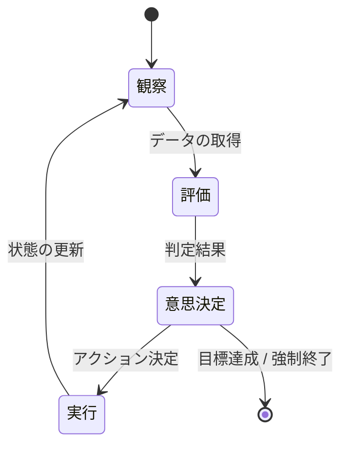
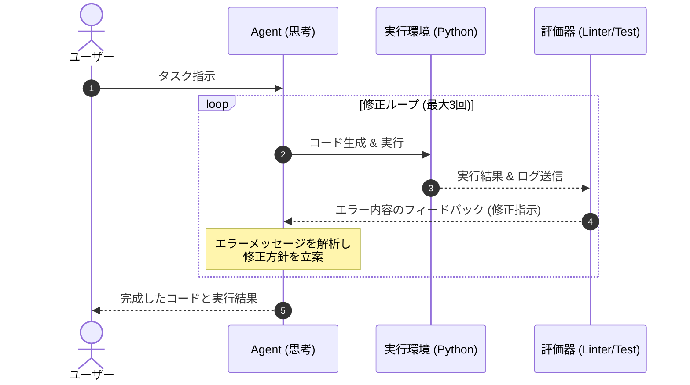
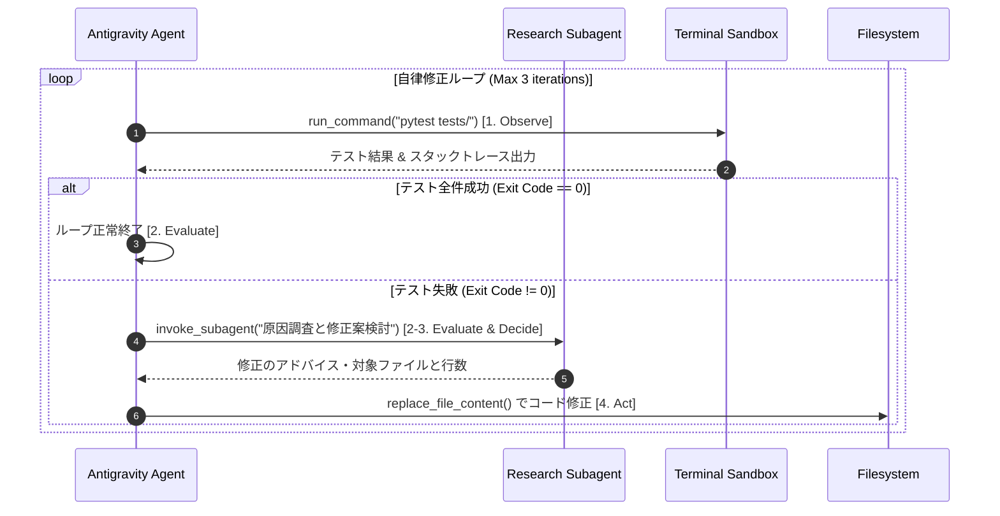

# ループエンジニアリング（Loop Engineering）完全ガイド

本ドキュメントは、「ループエンジニアリング」に関する基本概念、詳細メカニズム、実践的な活用・実行論、およびGoogle Antigravityを用いた具体的な実装例までを全章包括した統合メモです。

---

## 0_0 全体目次（インデックス）

- **1_0 概念説明：ループエンジニアリングの基礎**
  - [[#1_1 ループエンジニアリングとは|1_1 ループエンジニアリングとは]]
  - [[#1_2 なぜループ構造が重要なのか|1_2 なぜループ構造が重要なのか]]
  - [[#1_3 対象となる主な領域|1_3 対象となる主な領域]]
- **2_0 詳細説明：ループ構造のメカニズムと技術的構成要素**
  - [[#2_1 ループの基本構成要素|2_1 ループの基本構成要素]]
  - [[#2_2 フィードバックの仕組みと種類|2_2 フィードバックの仕組みと種類]]
  - [[#2_3 評価と調整のメカニズム（ガバナンスと制御）|2_3 評価と調整のメカニズム]]
- **3_0 実例と実行論：実践的アプローチとトラブルシューティング**
  - [[#3_1 AIエージェントにおける実装例|3_1 AIエージェントにおける実装例]]
  - [[#3_2 システム開発・運用における実例|3_2 システム開発・運用における実例]]
  - [[#3_3 設計時のベストプラクティス|3_3 設計時のベストプラクティス]]
  - [[#3_4 陥りやすい課題と対策（アンチパターンへの処方箋）|3_4 陥りやすい課題と対策]]
- **4_0 Google Antigravityを使用した形での具体的な実装例**
  - [[#4_1 Google Antigravityとは|4_1 Google Antigravityとは]]
  - [[#4_2 題材：自動バグ修正＆テスト検証ループ|4_2 題材：自動バグ修正＆テスト検証ループ]]
  - [[#4_3 アーキテクチャとループ制御の設計|4_3 アーキテクチャとループ制御の設計]]
  - [[#4_4 実際の実行フローとコード/指示例|4_4 実際の実行フローとコード/指示例]]
  - [[#4_5 まとめ：Antigravityでループを成功させるポイント|4_5 まとめ：Antigravityでループを成功させるポイント]]

---

# 1_0 概念説明：ループエンジニアリングの基礎

本章では、ループエンジニアリングの最も根幹となる「定義」「必要性」「活用領域」について解説します。

## 1_1 ループエンジニアリングとは

「**ループエンジニアリング（Loop Engineering）**」とは、システムやAI、あるいは業務プロセスにおいて**「評価と改善が繰り返される循環型の構造（フィードバックループ）」を意図的に設計・構築・最適化する技術や手法**のことです。

従来のプログラミングやシステム設計の多くは、「入力 A を受け取り、処理を行って、出力 B を出して終了する」という一方向（直線的）な流れが中心でした。

しかし、ループエンジニアリングでは**「出力結果や現状のステータスを観察・評価し、その情報を次の処理へ折り返して再反映させる」**という輪（Loop）の構造を作ります。これにより、一回の処理では達成できない複雑な目標を、段階的に達成できるようになります。


## 1_2 なぜループ構造が重要なのか

ループエンジニアリングが注目される最大の理由は、**「一発で完璧な成果を出せない、複雑で曖昧な問題が増えたこと」**にあります。

### 1_2_1 一発勝負（ワンショット）の限界
例えば、生成AI（LLM）に複雑なコード作成や長文記事の執筆を指示した場合、一回のプロンプト（ワンショット）だけで完全にエラーのない成果物を出すのは困難です。人間も一度で完璧な文章を書くのではなく、「推敲（すいこう）」を重ねるのと同様です。

### 1_2_2 段階的な品質向上（自己修復・自己改善）
ループ構造を組み込むことで、システムは以下のような振る舞いが可能になります。
1. 一度成果物を作る。
2. エラーや不十分な点を自らチェック（評価）する。
3. 修正案を考えて再度実行する。

このサイクルを回すことで、人間の介入なしに成果物の品質を限界まで引き上げることができます。

### 1_2_3 環境変化への追従
事前にすべてのパターンを予測できない動的な環境（Webブラウジング、自動運転、株価取引など）において、定期的に環境を観測し直して次の行動を決めるループ構造は不可欠です。

## 1_3 対象となる主な領域

ループエンジニアリングの考え方は、ソフトウェア開発だけでなく多岐にわたる領域で応用されています。

| 領域 | 具体的な適用例 | ループの役割 |
| :--- | :--- | :--- |
| **AIエージェント開発** | ReAct（Reason + Act）、Plan-and-Solve | AIが「思考→行動→観察」を繰り返し、自律的にタスクを遂行する。 |
| **プロンプトエンジニアリング** | Self-Reflect、Auto-Prompting | 生成結果をAI自身に採点させ、不十分ならプロンプトや回答を自己修正する。 |
| **ソフトウェア運用（DevOps）** | CI/CDパイプライン、自動テスト | テスト結果を開発環境にフィードバックし、バグの自動検知と修復を行う。 |
| **ビジネスプロセス** | PDCAサイクル、OODAループの自動化 | 業務データをリアルタイムに集計し、自動でリソース配置や意思決定を調整する。 |

---

# 2_0 詳細説明：ループ構造のメカニズムと技術的構成要素

本章では、ループエンジニアリングをシステムやプログラムとして実装する際の「内部メカニズム」「構成要素」「制御ロジック」について詳細に解説します。

## 2_1 ループの基本構成要素

効果的なループを構築するためには、単なる繰り返し処理ではなく、以下の**4つの核心的フェーズ**を独立したモジュールとして設計する必要があります。



### 2_1_1 1. 観察（Observe / Sense）
- **役割**: 現在のシステム状態、環境の情報、または直前の処理結果を正確に取得・抽出します。
- **具体例**: AIエージェントが前回の実行出力（生成されたコードやログ）、またはWebページのレスポンスHTMLを取得するステップ。

### 2_1_2 2. 評価（Evaluate / Judge）
- **役割**: 観察されたデータと「目標（理想状態）」を比較し、成果物の品質やエラーの有無を判定します。
- **具体例**: コードのビルドチェック、ユニットテストの実行結果分析、あるいは別の採点用AIによるスコアリング。

### 2_1_3 3. 意思決定（Decide / Plan）
- **役割**: 評価結果に基づき、「次にどのような修正を行うか」「このまま終了するか」といった方針を決定します。
- **具体例**: エラーメッセージを解析し、「ライブラリ不足のため `pip install` するコマンドを次に実行する」と判断するステップ。

### 2_1_4 4. 実行（Act / Execute）
- **役割**: 決定された方針に従い、実際に状態を変化させる操作を行います。
- **具体例**: ファイルの編集、コマンドの実行、プロンプトの再送信。

## 2_2 フィードバックの仕組みと種類

ループ内で受け渡される「フィードバック」には、目的に応じて主に2つの性質が存在します。

### 2_2_1 ネガティブフィードバック（収束型・修正）
- **メカニズム**: 「目標値」と「現状」のギャップ（エラー）を計算し、その**ギャップをゼロに近づける方向**に作用させます。
- **目的**: 安定化、バグ修正、品質の向上。
- **適用例**: 文法エラー数が0になるまで修正を繰り返す。

### 2_2_2 ポジティブフィードバック（増幅型・発散）
- **メカニズム**: 発生した変化の方向性をさらに**強化・増幅させる方向**に作用させます。
- **目的**: アイデアの創出、多様性の確保、急速な探索。
- **適用例**: 高評価を得たアイデアの派生案を大量生成する。

## 2_3 評価と調整のメカニズム（ガバナンスと制御）

ループ構造を安全かつ効率的に動作させるためには、ループを途中で正しく止める「**ガードレール（安全装置）**」の設計が最も重要です。

### 2_3_1 評価器（Evaluator）の二重化
品質を判定する評価器には、以下の2パターンを組み合わせるのが一般的です。

1. **決定論的評価（Deterministic Evaluation）**:
   - コンパイラ、プログラムの実行結果、正規表現、型チェックなど。高精度かつ決定論的。
2. **確率論的評価（Probabilistic Evaluation）**:
   - LLMによるレビュー、ルーブリック評価など。定性的で柔軟。

### 2_3_2 終了条件（Termination Criteria）の設定ロジック
```python
# 終了条件の概念コード例
while loop_count < MAX_RETRIES:
    result = execute_step(state)
    score, errors = evaluate(result)
    
    # 1. 成功条件
    if score >= QUALITY_THRESHOLD and not errors:
        return "SUCCESS", result
        
    # 2. 予算・コスト上限
    if total_tokens > MAX_TOKEN_BUDGET:
        return "FAILED_BUDGET_EXCEEDED", result
        
    state = update_state(state, errors)
    loop_count += 1

return "FAILED_MAX_RETRIES", result
```

---

# 3_0 実例と実行論：実践的アプローチとトラブルシューティング

本章では、ループエンジニアリングを実際のAIエージェント開発やシステム運用に適用するための「具体例」「設計のベストプラクティス」「アンチパターンへの対策（実行論）」を解説します。

## 3_1 AIエージェントにおける実装例

### 3_1_1 自己修正型コード生成エージェント（Self-Correction）


## 3_2 システム開発・運用における実例

### 3_2_1 自動障害回復システム（Self-Healing Systems）
- **観察**: メトリクスやヘルスチェックの監視。
- **評価**: サービス障害やSLO違反の検知。
- **意思決定**: 自動再起動やトラフィック迂回方針の決定。
- **実行**: インフラオーケストレーターによる自動制御。

## 3_3 設計時のベストプラクティス

1. **履歴史態（State History）の保持**: 「過去にどんな試行をし、なぜ失敗したか」というコンテキストを保持し、空回りを防ぐ。
2. **小さな独立ループのモジュール化**: 全体を包む巨大な1つのループではなく、目的ごとの小さなループを組み合わせる。
3. **ヒューマン・イン・ザ・ループ**: 危険な操作や上限超過時は人間の承認を挟む。

## 3_4 陥りやすい課題と対策（アンチパターンへの処方箋）

| 発生する課題（現象） | 主な原因 | 実行論としての対策 |
| :--- | :--- | :--- |
| **堂々巡り（無限ループ）** | AIが同じコード・テキストを微修正するだけで本質解決できない。 | **試行履歴のチェック**:<br>同じエラーが2回出たらアプローチを変更するよう制約を与える。 |
| **品質の劣化（破壊的修正）** | 修正によって元の正常な部分まで破壊される。 | **回帰テストの必須化**:<br>変更箇所だけでなく全体テストを毎回自動実行する。 |
| **コスト・リソースの爆発** | 評価基準が曖昧で無制限にループする。 | **ハード上限の設定**:<br>`Max_Loops` や `Max_Cost` を強制設定する。 |
| **ハルシネーションの増幅** | AIの誤った自己評価を信用して迷走する。 | **決定論的評価の優先**:<br>テスト結果やリンターの確定的な出力を優先する。 |

---

# 4_0 Google Antigravityを使用した形での具体的な実装例

本章では、Google DeepMindのエージェント環境「**Google Antigravity（AGY）**」の機能・仕組みを活用した具体的な実装方法を解説します。

## 4_1 Google Antigravityとは

Antigravityは、AIエージェントが自律的にソフトウェア開発タスクを行うための高度な環境であり、以下の機能により安全で確実なループ構築が可能です。

- **Sandboxed `run_command`**: 安全なサンドボックスでテスト・コマンドを実行し正確に「観察（Observe）」する。
- **Subagents (`invoke_subagent`)**: 重い解析や調査を子エージェントに任せ、メインのコンテキストを保護する。
- **Reactive Wakeup**: バックグラウンド処理の完了を自動通知で受け取り自律再帰する。

## 4_2 題材：自動バグ修正＆テスト検証ループ

「ユーザーから報告された不具合に対して、ユニットテストを実行してエラーを確認し、コードを修正し、テストが全件パスするまで自動で試行・修正を繰り返す」例を扱います。

## 4_3 アーキテクチャとループ制御の設計



## 4_4 実際の実行フローとコード/指示例

```python
# Antigravity内部におけるループ処理の流れ（イメージ）
MAX_ITERATIONS = 3
iteration = 0

while iteration < MAX_ITERATIONS:
    iteration += 1
    
    # 1. 観察 (Observe)
    test_result = run_command(CommandLine="pytest tests/test_discount.py", WaitMsBeforeAsync=5000)
    
    # 2. 評価 (Evaluate)
    if test_result.exit_code == 0:
        log("テストが成功しました。ループを終了します。")
        create_artifact("walkthrough.md", summary="バグ修正完了")
        break
        
    log(f"イテレーション {iteration}: テスト失敗を検知。エラーログを抽出中...")
    error_log = test_result.output
    
    # 3. 意思決定 (Decide) - サブエージェントを活用した深掘り
    subagent_response = invoke_subagent(
        TypeName="research",
        Role="Bug Analyzer",
        Prompt=f"以下のテストエラーログを分析し、修正すべきファイルと変更案を提示してください:\n{error_log}"
    )
    
    # 4. 実行 (Act)
    target_file = subagent_response.suggested_file
    fix_content = subagent_response.suggested_code
    
    replace_file_content(
        TargetFile=target_file,
        TargetContent=subagent_response.old_code,
        ReplacementContent=fix_content,
        Description=f"イテレーション {iteration} でのバグ修正適用"
    )

if iteration >= MAX_ITERATIONS and test_result.exit_code != 0:
    log("最大試行回数に達したため、修正を中断してユーザーの指示を仰ぎます。")
```

## 4_5 まとめ：Antigravityでループを成功させるポイント

1. **「ログ確認」の完全自動化**: `run_command` の戻り値をそのまま評価材料にし、勘に頼らない。
2. **サブエージェント（`invoke_subagent`）による文脈分離**: 重い解析を任せてメインのコンテキストを保護。
3. **明確な脱出条件とArtifact**: `walkthrough.md` で成果を報告し、失敗時は安全に停止。
