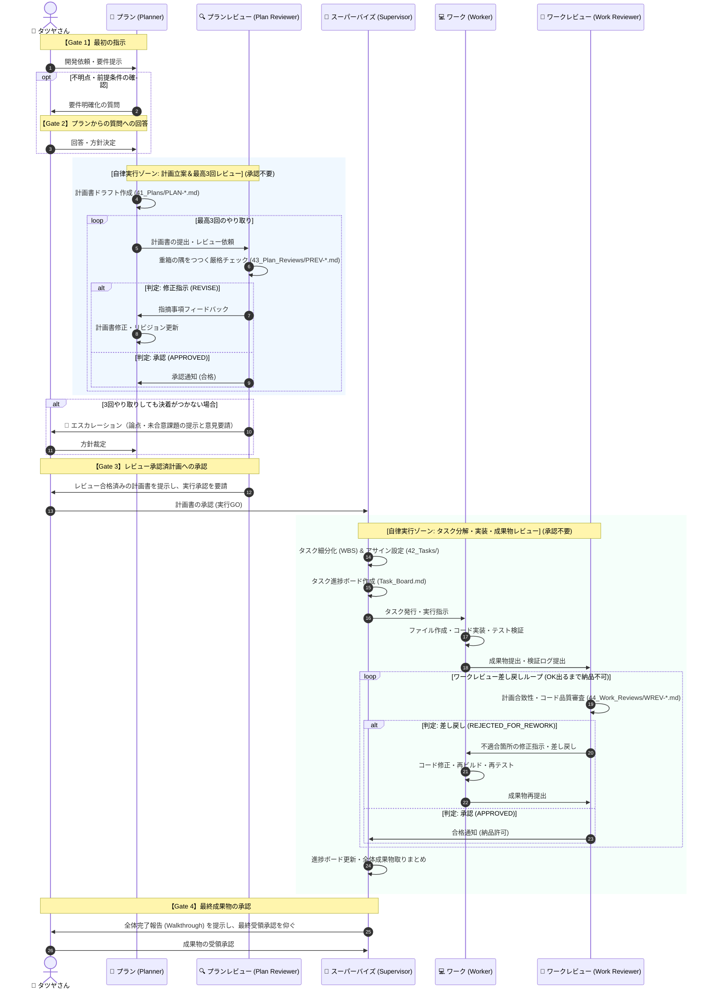

# 🤖 開発サブエージェント協調運用ガイド (Custom Agents Guide)

本ドキュメントは、`Dev_workspace` に配備された **5役2ループ開発サブエージェント協調体制（Plan, Plan Review, Supervisor, Work, Work Review）** のアーキテクチャ、各エージェントの責務、品質ループ制御（最高3回反復＆差し戻し原則）、タツヤさんへのエスカレーション規定、および運用のベストプラクティスを定めた総合運用ガイドです。

---

## 1. 5役2ループ協調アーキテクチャ

タツヤさんからの開発依頼を、最高品質かつ手戻りゼロで自律遂行するため、**「上流の要件定義ループ（最高3回）」** と **「下流の成果物検証ループ（OKが出るまで差し戻し）」** の2重の品質防壁を設置しています。

```mermaid
flowchart TD
    User([👤 タツヤさん]) <-->|Gate 1: 依頼提示 / Gate 2: 質問回答| Plan["📝 プラン (Planner)<br/>・要件ヒアリング / 質問<br/>・計画書作成 (41_Plans/)"]
    
    subgraph "上流品質防壁: 計画策定ループ (最高3回)"
        Plan <-->|レビュー依頼 / 修正指示| PlanRev["🔍 プランレビュー (Plan Reviewer)<br/>・重箱の隅チェック<br/>・最高3回反復判定 (43_Plan_Reviews/)"]
        PlanRev -.->|3回決着つかず: エスカレーション| User
    end

    PlanRev -->|✅ レビューOK| Gate3{"👤 タツヤさん<br/>【Gate 3】計画実行承認"}
    Gate3 -->|GO承認| Super["🧭 スーパーバイズ (Supervisor)<br/>・WBS分解 / タスク発行 (42_Tasks/)<br/>・ワーカー適切割当 / 進捗ボード管理"]

    subgraph "下流品質防壁: 実装＆成果物ループ (OK出るまで差し戻し)"
        Super -->|タスク発行・割当| Work["💻 ワーク (Worker / Specialists)<br/>・コード実装 / ファイル作成<br/>・テスト検証 / 成果物提出"]
        Work -->|成果物提出| WorkRev["🧐 ワークレビュー (Work Reviewer)<br/>・計画合致性 / コード品質精査<br/>・審査記録 (44_Work_Reviews/)"]
        WorkRev -->|❌ 未達: 修正差し戻し (最大5回)| Work
        WorkRev -.->|5回未達時: エスカレーション| User
    end

    WorkRev -->|✅ ワークレビューOK| SuperDone["🧭 スーパーバイズ<br/>全体完了取りまとめ (Walkthrough)"]
    SuperDone -->|【Gate 4】最終受領承認依頼| User
```

---

## 2. 協調ワークフローとタツヤさんの介入原則（4大承認ゲート）

本アーキテクチャでは、**タツヤさんが介入・承認するポイントを以下の4点に限定**し、それ以外のプロセス（計画レビュー反復、タスク分解、ワーカー実装、ワークレビュー差し戻し）はエージェント間で自律的・高速に進行します。

### 👤 タツヤさん介入ポイント（4大承認ゲート）
1. **【Gate 1】最初の指示**: 開発・機能追加・改善の目的や課題を提示する。
2. **【Gate 2】プランからの質問への回答**: プランが要件の曖昧さ・前提条件を検知して質問した際、回答・方針を与える。
3. **【Gate 3】レビュー承認済計画への承認**: プランレビューが厳格チェックを合格（またはエスカレーション判定）した計画書を確認し、実行GOを出す。
4. **【Gate 4】最終成果物の承認**: ワークレビューが合格を出した最終成果物（Walkthrough）を確認し、受領承認する。

> [!IMPORTANT]
> **上記1〜4以外のプロセス（最高3回の計画レビュー反復、タスク分解・アサイン、ファイル作成・コード実装、ワークレビューによる差し戻し修正ループなど）は、原則としてタツヤさんの事前個別承認を挟まず自律的に実行** します。



---

## 3. エージェント一覧と担当マップ

### 🌟 5大コア開発サブエージェント
| エージェント名 | 識別キー | 担当領域 | 主な役割・行動原則 | 関連テンプレート |
| :--- | :--- | :--- | :--- | :--- |
| **Requirement & Planning Agent** | `plan` | `40_Management/41_Plans/` | タツヤさんへのヒアリング、要件定義・実装計画書の策定、レビュー指摘に基づく自律修正（最大3回）。 | `70_Templates/TPL_Implementation_Plan.md` |
| **Rigorous Plan Reviewer Agent** | `plan_reviewer` | `40_Management/43_Plan_Reviews/` | 重箱の隅をつつく批判的検証。**原則OKを出すまで着手させない。最高3回まで**やり取りし、決着がつかない場合はタツヤさんに意見を求める。 | `70_Templates/TPL_Plan_Review.md` |
| **Specialist Supervisor Agent** | `supervisor` | `40_Management/42_Tasks/` | 承認済計画のWBS分解、タスク発行、ワーカーへの適切アサイン、進捗統括管理。 | `70_Templates/TPL_Supervision_Task.md`<br/>`70_Templates/TPL_Task_Board.md` |
| **Execution Worker Agent** | `work` | `20_Workspace/` 等の実装領域 | 割り当てられたタスクの実行（コード実装、ファイル作成、テスト実行等）。成果物をワークレビューへ提出。 | — |
| **Work Deliverables Reviewer Agent** | `work_reviewer` | `40_Management/44_Work_Reviews/` | 成果物の計画合致性・品質審査。**原則OKを出すまで納品させずワークに差し戻す**（最大5回上限）。 | `70_Templates/TPL_Work_Review.md` |

### 🛠️ 専門スペシャリストエージェント (スーパーバイズが適材適所でアサイン)
| エージェント名 | 識別キー | 担当領域 | 主な役割・機能 | 連携スクリプト・スキル |
| :--- | :--- | :--- | :--- | :--- |
| **Fullstack App Developer Agent** | `app_developer` | `20_Workspace/` | アプリケーション分離原則（ルート汚染防止）、Next.js/React/Node開発、ビルド・型検証 | `agent-app-developer` |
| **Loop Execution & Debugging Agent** | `loop_runner` | `10_Loop_Definitions/`<br/>`90_System/` | 自律修正ループ実行、エラーログ解析、デグレ検知・ロールバック、Reflection生成 | `loop_runner.py`<br/>`regression_checker.py` 他 |
| **Vault Structure & Governance Agent** | `vault_governance` | `00_Config/`<br/>`30_Document/` | Johnny.Decimal規約チェック、孤立ノート・リンク切れ検出、`Vault_Structure.md` 同期 | `vault_governance.py`<br/>`agent-vault-governance` |
| **Graph Knowledge Architect Agent** | `graph_architect` | `30_Document/`<br/>`20_Workspace/graph-studio/` | Vaultトポロジー解析、異分野架け橋抽出、Obsidian Canvas（`.canvas`）可視化出力 | `graph_engine/`<br/>`agent-graph-architect` |
| **Research & Knowledge Curator Agent** | `knowledge_curator` | `50_Library/`<br/>`30_Document/`<br/>`70_Templates/` | 外部資料・論文リサーチ、Markdownテンプレート適用、Wikiリンク付与によるナレッジ体系化 | `knowledge_curator.py`<br/>`agent-knowledge-curator` |
| **Git Sync & Operations Agent** | `git_operations` | リポジトリ全体 | 差分分析、Conventional Commits準拠の日本語メッセージ生成、一括同期 | `git_sync.py`<br/>`agent-git-operations` |

---

## 4. 管理ディレクトリとテンプレートの対応規則

タスクや計画は、Johnny.Decimal形式（`NN_Name`）に則り以下のフォルダおよびテンプレートを用いて管理されます。

```text
40_Management/
├── 41_Plans/            # プランが策定した計画書 (PLAN-YYYYMMDD-XX_*.md)
├── 42_Tasks/            # スーパーバイズが発行したタスク仕様書・進捗管理 (TASK-YYYYMMDD-XX_*.md, Task_Board.md)
├── 43_Plan_Reviews/     # プランレビューの検証記録・最高3回反復・エスカレーション履歴 (PREV-YYYYMMDD-XX_*.md)
└── 44_Work_Reviews/     # ワークレビューの成果物審査・差し戻し記録 (WREV-YYYYMMDD-XX_*.md)

70_Templates/
├── TPL_Implementation_Plan.md  # 計画書標準テンプレート
├── TPL_Plan_Review.md          # プランレビュー用厳格評価テンプレート (最高3回・エスカレーション規定)
├── TPL_Work_Review.md          # ワークレビュー用成果物合致性審査テンプレート (差し戻しループ)
├── TPL_Supervision_Task.md     # タスク仕様・アサインテンプレート
├── TPL_Task_Board.md           # タスク進捗ボード（カンバン）テンプレート
└── TPL_Review_Report.md        # レガシー互換用レビュー報告書テンプレート
```

---

## 5. 各エージェントの呼び出しとトリガー

### 自然言語トリガー例
* **計画・立案**:
  - 「〇〇機能の追加計画をプランエージェントと立てて」
  - 「この要件についてヒアリングして計画書を作って」
* **プランレビュー**:
  - 「計画書 `PLAN-xxx` をプランレビューに回して厳格チェックして」
  - 「重箱の隅をつついて懸念点を出して」
* **スーパーバイズ**:
  - 「計画書 `PLAN-xxx` をタスクに分解してワーカーに割り当てて」
  - 「現在のタスク進捗ボードを確認・更新して」
* **ワーク実行**:
  - 「タスク `TASK-xxx` をワーカーで実装して」
* **ワークレビュー**:
  - 「ワーカーの成果物が計画書に合致しているかワークレビューで審査して」
  - 「合致するまでワークに戻して修正させて」

---

## 6. 運用上の安全ルールとガバナンス
1. **タツヤさんの介入原則（4大承認ゲート）**:
   - タツヤさんが介入・承認を行うのは **①最初の指示、②質問への回答、③レビュー承認後計画の承認、④最終成果物の承認** の4点のみです。
   - それ以外の処理（計画ドラフト作成、最高3回の計画レビュー、タスク分解、ワーカー実装、ワークレビュー差し戻し）は、**原則としてタツヤさんの個別承認を待たずに自律的に実行** します。
2. **プランレビューの反復上限とエスカレーション**:
   - プランレビューのやり取りは最高3回まで。3回反復しても決着がつかない場合は必ずタツヤさんに意見を求め、勝手な妥協や独断承認を行いません。
3. **ワークレビューの差し戻し原則とガードレール**:
   - ワークレビューがOKを出すまでは絶対に納品を許可せず、ワークに差し戻します。万一、差し戻しが5回に達した場合は、無限ループを防ぐためタツヤさんへエスカレーションします。
4. **破壊的操作の事前確認**:
   - ファイル削除や大規模な上書きを行う場合は、事前に影響範囲を明示し、タツヤさんの承認を得ます。
5. **ディレクトリ分離の徹底**:
   - アプリ開発は `20_Workspace/<アプリ名>/` 配下に閉じ、スクリプトは `90_System/91_Scripts/`、一時ファイルは `90_System/93_Temporary/` に格納します。
6. **構成管理の即時同期**:
   - ディレクトリの作成・リネーム・削除時は、直ちに `00_Config/Vault_Structure.md` を最新状態に更新します。
