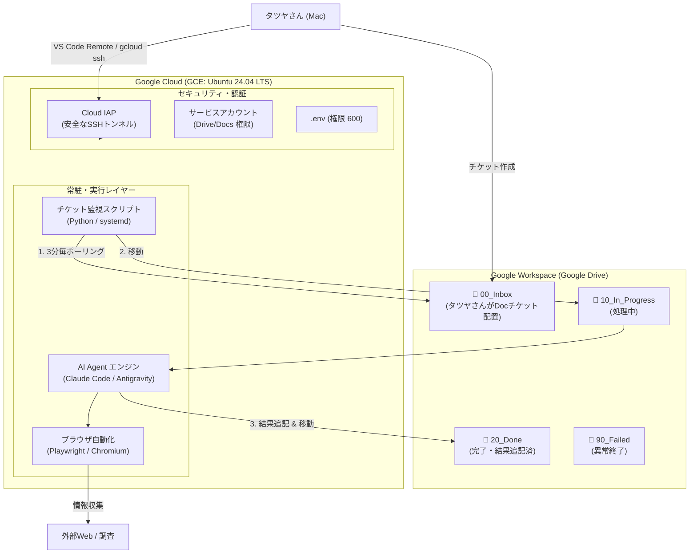
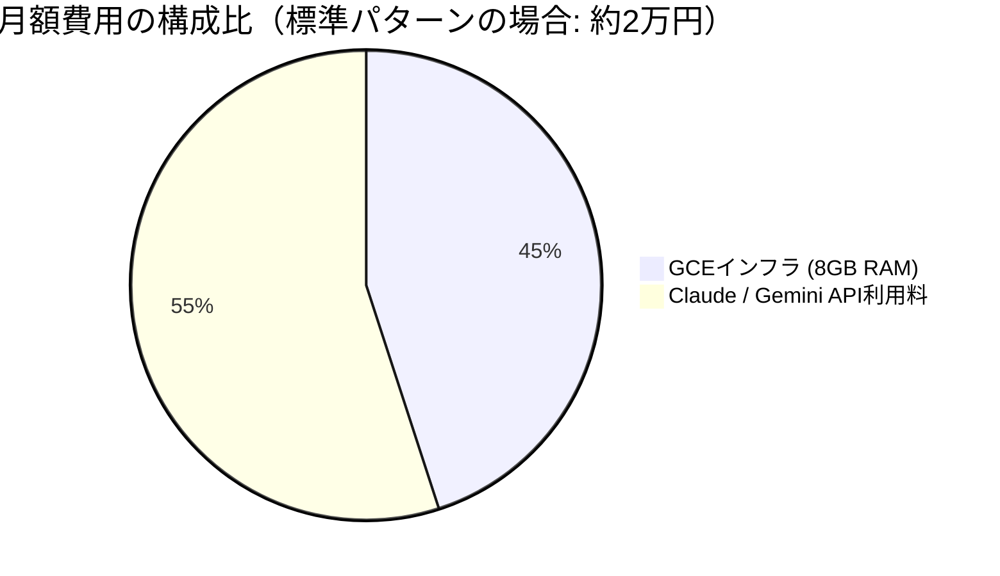

# GCP AI Agent 環境構築 & チケット駆動運用ガイド

本ドキュメントは、Google Cloud（Compute Engine: GCE）上に **Antigravity / Claude Code + Python** による自律型 AI Agent 環境を構築し、**Google Docs をチケットとして自律処理するワークフロー** を実現するための総合設計・運用ガイドです。

---

## 1. 全体アーキテクチャ

Google Cloud と Google Workspace（Google Drive / Docs）を連携させ、安全・高機能・低コストで稼働させるアーキテクチャです。



---

## 2. 月額費用の詳細予測

月額費用は「① Google Cloud インフラ費用（固定費）」と「② LLM API利用料（従量課金）」で構成されます。
*(※ 1ドル = 約155円換算)*

### 2.1 インフラ費用（GCE: Compute Engine）

| 運用スタイル | 推奨マシンタイプ | スペック | 月額（USD） | 月額（日本円） | 特徴 |
| :--- | :--- | :--- | :--- | :--- | :--- |
| **標準（24時間常駐）**<br/>**※推奨** | `e2-standard-2` | 2 vCPU / 8GB RAM<br/>SSD 50GB | **約 \$55 〜 \$65** | **約 8,500 〜 10,000 円** | Playwrightブラウザ自動化とNode/Python並行処理が快適 |
| **軽量（24時間常駐）** | `e2-medium` | 1 vCPU / 4GB RAM<br/>SSD 30GB | **約 \$28 〜 \$35** | **約 4,500 〜 5,500 円** | 最小限。大量スクレイピング時はメモリに注意 |
| **オンデマンド運用** | `e2-standard-2` | 1日約4時間稼働想定 | **約 \$12 〜 \$20** | **約 1,800 〜 3,000 円** | ディスク維持費＋稼働時間分のみ課金 |

> [!TIP]
> **リージョン選定**:
> GCEのリージョンを東京（`asia-northeast1`）ではなく、米国（`us-central1` アイオワなど）に設定すると、**VM費用が約15〜20%安価**になります。

### 2.2 LLM API 利用料金（従量課金）

Claude Code は自律的にコンテキスト（ファイル内容・コマンド結果・差分）を往復させるため、一般的なチャット画面よりもトークン消費が多くなります。

| 利用スタイル | 作業イメージ | 月額目安（USD） | 月額目安（日本円） |
| :--- | :--- | :--- | :--- |
| **ライト** | 週末や夜間に数回タスク実行、軽量リサーチ | **約 \$15 〜 \$30** | **約 2,500 〜 4,500 円** |
| **ミドル（標準）** | 平日毎日数回のコード作成、日常的なWeb調査 | **約 \$50 〜 \$100** | **約 7,500 〜 15,500 円** |
| **ヘビー** | 24時間監視ボット、長時間の自律反復 | **約 \$150 〜 \$250+** | **約 23,000 〜 38,000 円+** |

### 2.3 総合シミュレーション



1. **【賢く節約】使わない時は停止 ＋ ミドル利用**: **約 7,500 〜 10,500 円 / 月**
2. **【標準運用】24時間常駐（8GB RAM）＋ ミドル利用**: **約 17,000 〜 21,000 円 / 月**
3. **【フル稼働】24時間常駐 ＋ ヘビー自律稼働**: **約 30,000 〜 45,000 円 / 月**

---

## 3. GCE 環境構築ステップ

### Step 1: インフラ作成 (GCE)
* **OS**: Ubuntu 24.04 LTS
* **マシン**: `e2-standard-2`（us-central1 または asia-northeast1）
* **アクセス制御**: Cloud IAP（Identity-Aware Proxy）を有効化し、ポート22を直接外部公開しない。

```bash
# Macローカルからのセキュア接続コマンド
gcloud compute ssh <インスタンス名> --tunnel-through-iap --zone=<ゾーン名>
```

### Step 2: 開発・実行基盤のセットアップ
```bash
# 1. 基本パッケージ
sudo apt update && sudo apt upgrade -y
sudo apt install -y git curl wget build-essential tmux jq unzip

# 2. Node.js (v22 LTS - Claude Code用)
curl -fsSL https://deb.nodesource.com/setup_22.x | sudo -E bash -
sudo apt install -y nodejs

# 3. Python (uv - 超高速パッケージ管理)
curl -LsSf https://astral.sh/uv/install.sh | sh
source ~/.bashrc

# 4. Claude Code CLI の導入
sudo npm install -g @anthropic-ai/claude-code
```

### Step 3: スクレイピング & ブラウザ自動化基盤 (Playwright)
```bash
# ワークスペース作成
mkdir -p ~/agents-workspace && cd ~/agents-workspace
uv init

# 必要なパッケージ追加
uv add playwright beautifulsoup4 httpx requests google-api-python-client google-auth duckduckgo-search

# Playwright専用ブラウザ（Chromium）とLinux依存ライブラリを一括導入
uv run playwright install --with-deps chromium
```

---

## 4. Google Docs チケット駆動運用の詳細設計

人間とAIエージェントが非同期で連携するための「チケット駆動型（カンバン方式）」設計です。

### 4.1 Google Drive のフォルダ構成

```text
📁 MyDrive/Agent_Tickets/
├── 📁 00_Inbox/         # タツヤさんが新規チケット（Doc）を作成・配置する場所
├── 📁 10_In_Progress/   # エージェントが検知し、現在処理中の場所（二重実行防止）
├── 📁 20_Done/          # 処理完了。結果がDoc末尾に追記された状態
└── 📁 90_Failed/        # エラー発生時の退避場所
```

### 4.2 チケット（Google Docs）の標準フォーマット

エージェントが誤解なくタスクを実行できるよう、Markdown風のシンプルな見出し構成を採用します。

```markdown
# [チケット] 競合サービスの料金プラン比較調査

## 1. 依頼内容
〇〇分野における主要3社（A社、B社、C社）の料金プランと主な機能を調査して比較表を作成してください。

## 2. 実行アクション
- [x] Webスクレイピング & 最新情報リサーチ
- [ ] ドキュメント要約
- [ ] コード作成・検証

## 3. 出力要件
- 各社の「プラン名」「月額料金」「主要機能」「制限事項」を整理すること。
- 本ドキュメントの「## 4. 実行結果」に追記すること。

---
## 4. 実行結果
（※ここにエージェントが調査結果を自動追記します）
```

### 4.3 チケット監視スクリプト（概要設計）

Pythonから Google Drive API の「エクスポート機能」を使うことで、Google Docs の複雑な装飾を意識せず、**プレーンテキスト / Markdown として一発で取得**できます。

```python
# ticket_watcher.py (要点コード)
from googleapiclient.discovery import build
from google.oauth2 import service_account
import subprocess

# Drive API の初期化 (サービスアカウント認証)
drive = build('drive', 'v3', credentials=credentials)

def check_and_execute_tickets():
    # 1. 00_Inbox フォルダ内のファイル一覧を取得
    results = drive.files().list(
        q="'<INBOX_FOLDER_ID>' in parents and trashed=false",
        fields="files(id, name, mimeType)"
    ).execute()
    files = results.get('files', [])

    for file in files:
        doc_id = file['id']
        # 2. 10_In_Progress フォルダへ即時移動（多重起動防止）
        move_file(doc_id, from_folder='<INBOX_ID>', to_folder='<IN_PROGRESS_ID>')

        # 3. Google Docs の内容を Markdown/テキストとしてエクスポート取得
        content = drive.files().export_media(fileId=doc_id, mimeType='text/plain').execute().decode('utf-8')

        # 4. Agent（Claude Code / Antigravity / Pythonスクリプト）を呼び出し
        response = run_agent_task(content)

        # 5. 結果を Google Docs に追記（Docs API）
        append_to_doc(doc_id, response)

        # 6. 20_Done フォルダへ移動
        move_file(doc_id, from_folder='<IN_PROGRESS_ID>', to_folder='<DONE_ID>')
```

### 4.4 常駐化設定（systemd）

SSHを切っても監視スクリプトが24時間停止しないよう、Linuxのサービスとして登録します。

```ini
# /etc/systemd/system/ticket-watcher.service
[Unit]
Description=Google Drive Ticket Watcher Daemon
After=network.target

[Service]
User=tatsuya
WorkingDirectory=/home/tatsuya/agents-workspace
ExecStart=/home/tatsuya/.cargo/bin/uv run python ticket_watcher.py
Restart=always
RestartSec=10
EnvironmentFile=/home/tatsuya/agents-workspace/.env

[Install]
WantedBy=multi-user.target
```

```bash
sudo systemctl daemon-reload
sudo systemctl enable --now ticket-watcher.service
```

---

## 5. ガードレールとコスト最適化の鉄則

1. **月額予算アラート & ハードリミットの必須化**:
   * Google Cloud Console および Anthropic Console にて、月額上限（例: 2万円）を超えた場合の自動停止・アラートメールを設定。
2. **モデルの使い分け（ハイブリッド運用）**:
   * **高度なコーディング・複雑な調査**: Claude 3.5 / 3.7 Sonnet
   * **日常的なテキスト抽出・単純要約・一次選別**: Gemini 2.0 Flash / 1.5 Flash（料金はSonnetの約1/15以下）
3. **安全な作業ディレクトリ制限**:
   * エージェントには `~/agents-workspace/` 配下の操作権限のみを与え、ホストOSの重要設定やSSH鍵ディレクトリへの直接書き込みを制限。

---

## 6. 関連ドキュメント・リンク
- [[00_Config/Vault_Structure|Vault_Structure.md]] - Vault全体の構成管理ドキュメント
- [[30_Document/01_Rules/04_Custom_Agents_Guide|04_Custom_Agents_Guide.md]] - カスタムエージェント運用ガイド
- [[10_Loop_Definitions/Loop_Engineering|Loop_Engineering.md]] - ループエンジニアリング定義
