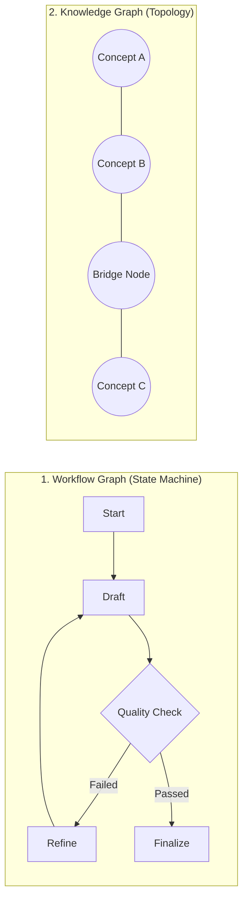

# 01_[[グラフエンジニアリング]]_概念と基礎

> [!NOTE] [[コア]]・クエスチョン / [[アーキテクチャ]]の要点
> [[グラフエンジニアリング]]とは何か？従来の線形パイプラインやDAG（有向非巡回グラフ）と何が異なり、なぜ現代の[[自律エージェント]]や知識基盤において不可欠なのか、その本質と対象領域を解き明かす。

---

本ドキュメントでは、[[グラフエンジニアリング]]の最も根幹となる「定義」「StateGraphとDAGの相違」「必要性」「対象領域」について体系的に解説します。

---

## 1. [[グラフエンジニアリング]]とは

「**[[グラフエンジニアリング]]（Graph Engineering）**」とは、システムやエージェントの振る舞い、あるいは知識のトポロジーを**「ノード（状態・関数・エンティティ）」と「エッジ（遷移・依存・推論・データフロー）」から成る有向グラフ**としてモデリングし、堅牢に制御・実行・解析・可視化する技術体系です。

AIエージェント工学およびセカンドブレイン（ナレッジマネジメント）において、グラフエンジニアリングは主に以下の2つの側面を持ちます：

1. **Workflow Graph Engineering（エージェント制御グラフ）**:
   - エージェントの思考・行動・評価ループを有向状態グラフ（[[StateGraph]]）として定義し、条件分岐、並列処理、サイクル（循環・再試行）、人間介入（Human-in-the-loop）を精密に制御する。
2. **Knowledge Graph Engineering（知識トポロジー・GraphRAG）**:
   - ドキュメントや概念間の接続関係を有向ナレッジグラフとして構築し、[[PageRank]]、媒介中心性、最短経路探索、異分野創発（Cross-Domain Connections）を数理的に解析・活用する。

---

## 2. 線形パイプライン・DAG・StateGraph の比較

システムをグラフとして捉えるアプローチは進化を続けており、エージェントシステムの要求に応じて表現力が高まっています。

| 構造種別 | サイクル（ループ） | 状態管理 (State) | 特徴と限界 | 代表例 |
| :--- | :--- | :--- | :--- | :--- |
| **線形パイプライン (Linear Pipeline)** | 不可 (A ➔ B ➔ C) | 単純な直列引き渡し | 途中で自己修正や分岐ができず、1ステップの失敗で全体が破綻する。 | 初期のプロンプトチェーン |
| **有向非巡回グラフ (DAG)** | 不可 (非巡回) | タスク間の依存解決 | 並列実行（Fan-out/Fan-in）は可能だが、反復推敲や再試行ループを表現できない。 | Airflow, Prefect, 通常のCI/CD |
| **状態グラフ (StateGraph)** | **完全対応（巡回可能）** | **共有状態 (Shared State) + Reducer** | 条件付きエッジにより動的な推論ループ、自己修正、タイムトラベル（過去ステップへの巻き戻し）が可能。 | LangGraph, Antigravity Graph Engine |

---

## 3. なぜグラフエンジニアリングが重要なのか

### 3.1 複雑な推論・推敲ループの決定論的制御
エージェントに「完成度が高まるまで推敲せよ」「エラーが発生したら別のツールを試せ」といった自律的なフィードバックループを実行させる際、自然言語プロンプトだけに頼ると無限ループや脱線を防げません。グラフ構造で状態遷移を明示的に定義することで、ループ回数の上限や脱出条件を数学的・決定論的に制御できます。

### 3.2 タイムトラベル（Time-Travel）デバッグと再現性
グラフの各ステップにおける状態（State）をチェックポイントとして保存することで、「ステップ3のノード実行直前の状態」に戻って別の分岐を試す、あるいはエラー発生箇所の状態を完全に再現してデバッグすることが可能になります。

### 3.3 ナレッジグラフとGraphRAGによる異分野創発
単純なセマンティック検索（ベクトル検索）では見落とされがちな「3ホップ先の関連概念」や「異分野（ビジネスと哲学とAI工学）を繋ぐ架け橋ノード」を、グラフ理論アルゴリズムによって正確に掘り起こし、エージェントの推論コンテキストに注入できます。

---

## 4. 対象となる主な領域

| 領域 | 具体的な適用例 | グラフエンジニアリングの役割 |
| :--- | :--- | :--- |
| **自律型AIエージェント** | リサーチエージェント、コードリファクタラー | 計画 ➔ 実行 ➔ 評価 ➔ 修正のサイクルを有向グラフとして実行。 |
| **Second Brain / Obsidian** | 思考パイプライン、知識結晶化 | 10_Captureから40_Knowledgeへの昇華フローの自動化、リンク解析。 |
| **GraphRAG（高度検索）** | 企業内ナレッジベース、研究論文横断探索 | エンティティ間のリレーションネットワークを辿り、文脈の欠落を防ぐ。 |
| **対話型UI / 可視化** | Graph Studio、Obsidian Canvas | 実行中のエージェントの状態や知識トポロジーをWebやCanvas上に直感的に表示。 |

---

## 🔗 Connected Notes

- 🗺️ [[MOC|ハブノート]]: [[00_Graph_Engineering]]
- ➡️ 次のノート: [[02_グラフエンジニアリング_内部メカニズムと構造]]
- 📚 関連用語: [[StateGraph]], [[ナレッジグラフ]], [[有向非巡回グラフ|有向グラフ]], [[PageRank]], [[GraphRAG]]
