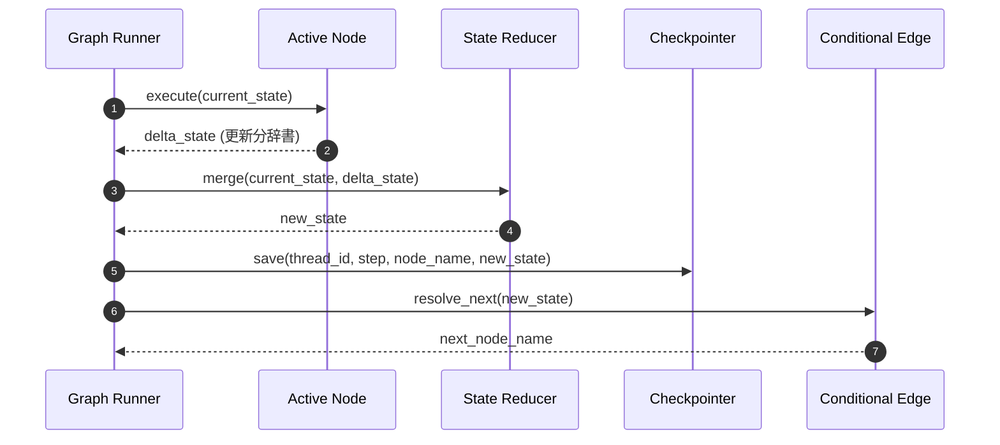

# 02_[[グラフエンジニアリング]]_内部メカニズムと構造

> [!NOTE] [[コア]]・クエスチョン / [[アーキテクチャ]]の要点
> [[StateGraph]]の内部では状態（State）とノード遷移がどのように処理されているのか？Reducerによる状態マージ、Checkpointerによるスナップショット永続化、およびナレッジグラフ解析（[[PageRank]]・最短経路）の数理メカニズムを解剖する。

---

本ドキュメントでは、[[グラフエンジニアリング]]のエンジンを構成する4大内部メカニズム（状態管理、ルーティング、スナップショット永続化、トポロジー数理）について詳細に解説します。

---

## 1. StateGraph 実行ループと状態遷移メカニズム

StateGraphの中心は、**「不変な状態（State）の受け渡しと、純粋関数（Node）によるデルタ更新、およびReducerによるマージ」** です。



### 1.1 状態のマージ規則 (State Reducers)
ノードは状態全体を直接破壊的変更するのではなく、**差分（Delta）** を返します。グラフエンジンは登録されたReducer関数に基づき、差分を統合します：

- **上書き (Overwrite)**: デフォルト動作。同じキーの値を新しい値で置換。
- **リスト追加 (Append / Concat)**: メッセージ履歴やログ配列などに `current_list + new_items` を適用。
- **数値加算 (Add)**: 試行回数カウンタやトークン数加算。

---

## 2. Checkpointer とタイムトラベルの構造

Checkpointerは、各ステップ完了時の `new_state` を `(thread_id, step_index)` をキーとして永続ストレージ（メモリ、JSONファイル、SQLite等）に保存します。

```
[Storage Hierarchy]
00_System/Temporary/graph_checkpoints/
└── run_knowledge_emergence_1724580000.json
    ├── Step 0 (START)    -> State: { seeds: ['00_Graph_Engineering'] }
    ├── Step 1 (Extract)  -> State: { seeds: [...], raw_links: [...] }
    ├── Step 2 (Traverse) -> State: { seeds: [...], subgraph: { nodes: 22, edges: 102 } }
    └── Step 3 (Insights) -> State: { ..., insights: "..." }
```

### タイムトラベル（巻き戻し）の実行フロー
1. ユーザーまたはエージェントが過去の `step = k` を指定。
2. Checkpointerからそのステップのスナップショットを取得。
3. 新しい `thread_id`（例: `thread_fork_k`）を発行し、その状態を初期値としてグラフを再開。
4. これにより、過去の特定地点からの**「もし別の判断をしていたら（What-if）」** の分岐探索が可能になります。

---

## 3. ナレッジグラフ解析アルゴリズムの数理

Vault全体のMarkdownノート群から構築されたナレッジグラフ $G = (V, E)$ に対し、以下のアルゴリズムを適用します。

### 3.1 PageRank によるノード重要度計算
ノード $u$ のPageRank値 $PR(u)$ は、ダンピングファクター $d = 0.85$ として以下のべき乗法（Power Iteration）で計算されます：

$$PR(u) = \frac{1 - d}{|V|} + d \sum_{v \in In(u)} \frac{PR(v)}{|Out(v)|}$$

- **意味**: 多くの重要なノートからリンクされているノート（ハブ概念や基本概念）ほど、高いスコアを獲得します。

### 3.2 異分野架け橋（Cross-Domain Bridge）スコア
ノート $u$ の所属ドメインを $D(u)$ とし、接続先ノード集合のドメインの多様性を測定します：

$$BridgeScore(u) = |\{ D(v) \mid v \in (In(u) \cup Out(u)) \land D(v) \neq D(u) \}| \times PR_{norm}(u)$$

- **意味**: 「10_Capture（メモ）」と「30_Studies（技術探究）」と「40_Knowledge（知識）」を横断してリンクを持つノード（例: `[[自律エージェント]]`, `[[アーキテクチャ]]` 等）が最上位に浮上し、異分野間の創発ポイントとして特定されます。

---

## 🔗 Connected Notes

- ⬅️ 前のノート: [[01_グラフエンジニアリング_概念と基礎]]
- 🗺️ [[MOC|ハブノート]]: [[00_Graph_Engineering]]
- ➡️ 次のノート: [[03_グラフエンジニアリング_実践設計と課題対策]]
- 📚 関連用語: [[StateGraph]], [[PageRank]], [[トポロジー]], [[Reducer]], チェックポイント
