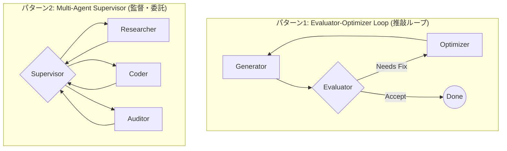

# 03_[[グラフエンジニアリング]]_実践設計と課題対策

> [!NOTE] [[コア]]・クエスチョン / [[アーキテクチャ]]の要点
> グラフベースの[[自律エージェント]]や知識パイプラインを本番運用する際、どのような落とし穴（無限ループ、状態爆発、並列合流の競合）が存在し、どのように回避・設計すべきか？

---

本ドキュメントでは、[[グラフエンジニアリング]]の実践において直面する主要な課題と、それを解決するための設計パターン（ベストプラクティス）を解説します。

---

## 1. 主要な設計課題とアンチパターン

### 1.1 無限ループとリソース枯渇 (Infinite Execution Loop)
- **問題**: 条件付きエッジの脱出条件が不完全な場合（例: LLMの品質判定が常に「不合格」を返し続ける）、エージェントが無限に反復実行し、APIコストやCPUを浪費する。
- **対策**:
  - **最大ステップ数ガード (`max_steps`)**: グラフエンジンレベルで強制上限（例: 50ステップ）を設置。
  - **フォールバック脱出ルート**: ループカウンタ（`iteration >= 3`）を状態に保持し、一定回数を超えた場合は自動的にエスカレーションまたは強制完了ノードへ分岐。

### 1.2 状態の肥大化とコンテキスト汚染 (State Bloat)
- **問題**: すべてのノードの中間生データ（大量のWebスクレイピング結果や全ファイル本文）をそのままState辞書に保持し続けると、メモリ消費とトークン消費が指数関数的に増大する。
- **対策**:
  - **アトミック状態設計**: 状態には「次のノードの判断に必要な構造化データやID」のみを格納し、生テキストは一時ファイルに退避するか、ノード完了時に要約して圧縮する。

### 1.3 並列分岐・合流時の状態競合 (Fan-out / Fan-in Conflicts)
- **問題**: ノードAから並列にノードBとノードCを呼び出し、両者が同時に同じキー `output` を更新しようとすると、競合（Race Condition）が発生する。
- **対策**:
  - **名前空間の分離**: ノードBは `b_output`、ノードCは `c_output` に書き込む。
  - **リストReducerの明示**: `outputs: Annotated[list, add]` のように、並列ノードの結果が配列に安全にアペンドされるようReducerを定義する。

---

## 2. 3大実践デザインパターン

### パターン 1: Evaluator-Optimizer Loop（生成・評価・最適化ループ）
- 初稿作成（Generate）➔ 監査（Audit/Evaluate）➔ 改善（Refine）のサイクルを構成。
- 監査ノードはチェックリスト（Frontmatter規格、内部リンク存在確認など）を厳格に照合し、条件付きエッジで合否を判定。

### パターン 2: Multi-Agent Supervisor（階層型監督グラフ）
- 中央の「Supervisorノード」が現在の状態を監視し、次に委託すべき専門サブエージェント（Researcher, Coder, Auditor）を動的ルーティングで選択。

### パターン 3: Human-in-the-loop（承認割り込み）
- 破壊的操作（ファイルの削除や外部プッシュなど）の直前ノードでグラフの実行を一時中断（Interrupt）し、Checkpointerに状態を保存。ユーザーの承認が得られた後に中断ノードから再開。

---

## 🔗 Connected Notes

- ⬅️ 前のノート: [[02_グラフエンジニアリング_内部メカニズムと構造]]
- 🗺️ [[MOC|ハブノート]]: [[00_Graph_Engineering]]
- ➡️ 次のノート: [[04_グラフエンジニアリング_Antigravity実装例]]
- 📚 関連用語: [[StateGraph]], [[LangGraph]], [[Human-in-the-loop]], [[Reducer]]
