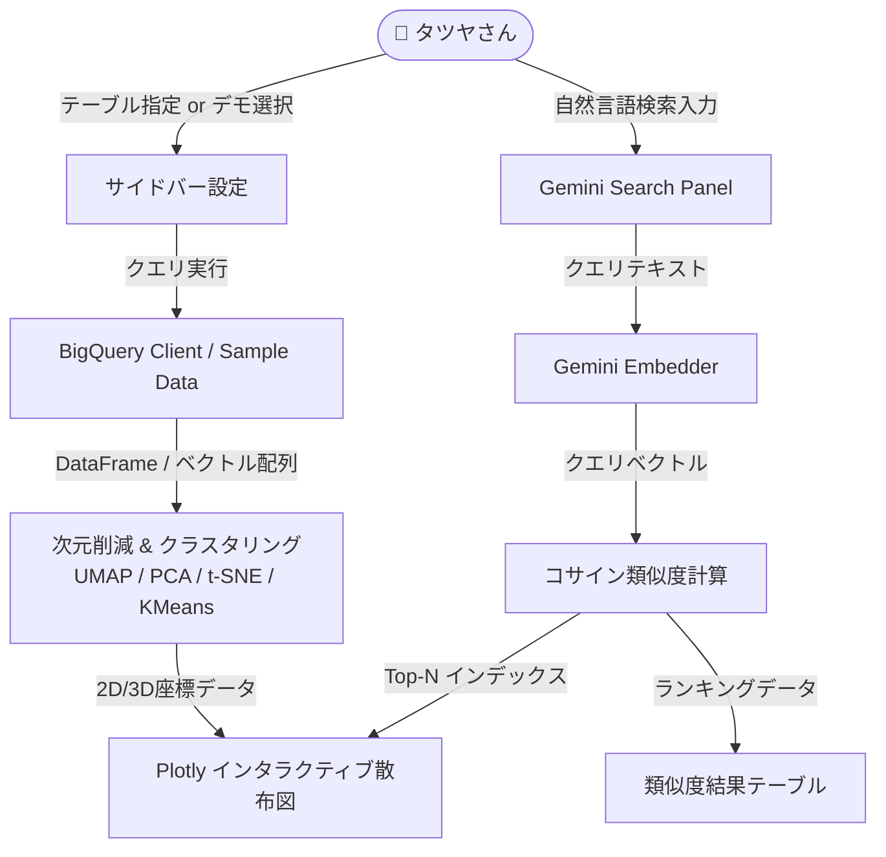

# 📋 計画書: BigQueryベクトル情報可視化ツール（BQ Vector Visualizer）構築計画書

## 1. 概要・背景
- **目的**: 
  BigQueryに格納された高次元埋め込みベクトルデータ（Text Embeddings, Multimodal Embeddings等）を直感的に可視化・分析・探索するためのWebダッシュボード `BQ Vector Visualizer` を構築する。
- **背景・現状の課題**: 
  - 近年、RAG（Retrieval-Augmented Generation）や類似推薦、検索システムの発展によりBigQuery上にベクトルデータ（`ARRAY<FLOAT64>`）を蓄積するケースが急増している。
  - しかし、高次元ベクトル（768次元、1536次元等）は数値の配列に過ぎず、コンソール上ではデータ全体のトポロジー（クラスタ構造、分布の偏り、外れ値）や検索結果の妥当性を視覚的に把握することが困難である。
  - タツヤさんの環境（Mac, Python, gcloud設定済み）を活かし、Streamlit + Plotly + 次元削減ライブラリ（UMAP/PCA/t-SNE）を統合した軽量かつ高性能な専用探索ツールが求められている。
- **達成目標 (ゴール)**: 
  1. `20_Workspace/bq-vector-visualizer/` 配下に、Streamlitベースの独立したPythonデータアプリケーションを新規構築。
  2. 画面UIから任意のBigQueryプロジェクト・データセット・テーブル・ベクトルカラム・メタデータカラムを柔軟に指定してクエリ・取得できる汎用接続機能の実装。
  3. UMAP / PCA / t-SNE による次元削減エンジンを実装し、インタラクティブな2D/3D散布図（Plotly）でクラスタリング・色分け表示。
  4. Gemini API連携による「自然言語ベクトル検索 & 近傍ハイライト」機能の実装（入力テキストから埋め込みを生成し、BigQueryデータ群の中で最も近いTop-N件を散布図上でダイナミックに強調）。
  5. BigQueryテーブルが手元にない場合でもワンクリックで即座に試せる「デモ・サンプルデータ生成（200件のトピック別埋め込みデータ）」機能の搭載。
  6. ワンクリック起動スクリプト（`run.sh`）、仮想環境管理設定（`pyproject.toml` / `requirements.txt`）、単体テスト群の整備。
  7. `00_Config/Vault_Structure.md` の構成管理完全同期。

---

## 2. 要件定義

### 2.1 機能要件 (Must / Should / Want)
- [x] **FR-01 (Must - BigQuery接続 & 汎用スキーマ対応UI)**:
  - サイドバーから GCP Project ID（デフォルト: `vocal-affinity-476201-j5`）、Dataset ID、Table ID を指定可能。
  - スキーマ自動検出: 指定テーブルのスキーマを取得し、ベクトル列候補（`ARRAY<FLOAT64>`）やラベル・テキスト列候補をセレクトボックスで選択可能。
  - LIMIT句による取得行数制限（デフォルト500件、スライダーで100〜5,000件）およびDRY RUNバイト数確認によるクエリコスト防止。
  - 認証はローカルの gcloud Application Default Credentials (ADC) を自動活用。
- [x] **FR-02 (Must - 高次元ベクトル次元削減 & 2D/3Dインタラクティブ可視化)**:
  - 次元削減アルゴリズム: **UMAP**（トポロジー保持）、**PCA**（主成分分析・高速）、**t-SNE**（局所クラスタ強調）を選択可能。
  - 表示モード: 2D散布図 / 3D散布図のワンクリック切り替え。
  - クラスタリング & 色分け: K-Meansクラスタリング（クラスタ数 $K$ をスライダーで調整可能）または既存のカテゴリ列による色分け。
  - Plotlyによるリッチなホバー情報: データID、テキスト抜粋、クラスタ番号、元ベクトル次元数等の詳細ツールチップ。
- [x] **FR-03 (Must - Gemini自然言語検索 & 近傍ベクトルハイライト)**:
  - 検索バーに自然言語（例: 「AIエージェントの自律制御に関する技術」）を入力。
  - Gemini API（`text-embedding-004` 等）を呼び出してクエリベクトルの埋め込みを即座に生成。
  - 取得済みデータセットとのコサイン類似度を一括計算し、Top-K（例: 5件）を散布図上で強調マーカー（大サイズ・星型・別色）としてハイライト。
  - 類似度ランキングテーブル（類似度スコア、テキスト内容、メタデータ）を並行表示。
  - APIキーは環境変数 `GEMINI_API_KEY` またはUI入力（マスク表示）で安全に設定可能。
- [x] **FR-04 (Must - デモ用サンプルデータ生成機能)**:
  - 「デモデータをロード」ボタンを設置。BigQueryのテーブル未作成・未接続時でも、多次元埋め込みベクトルとメタデータ（テクノロジー、ビジネス、サイエンス、日常など4カテゴリ）を含むサンプル200件を即座に生成し、ツールの全機能を体験可能にする。
- [x] **FR-05 (Should - コサイン類似度マトリクス & ベクトルインスペクタ)**:
  - 検索上位アイテム間、または選択アイテム間のコサイン類似度ヒートマップ表示。
  - クリックした個別ベクトルの詳細情報（ノルム、最大・最小値、次元数、生ベクトル値先頭N件）のインスペクタ表示。
- [x] **FR-06 (Must - 起動スクリプト & 依存関係の独立管理)**:
  - `run.sh` によるワンクリック起動（uv による仮想環境自動作成または既存環境確認、ブラウザ自動オープン）。
  - `requirements.txt` / `pyproject.toml` による厳格な依存関係定義。

### 2.2 非機能要件 (制約・セキュリティ・品質)
- **Johnny.Decimal規約**: 
  - アプリケーション配置: `20_Workspace/bq-vector-visualizer/`
  - 構成定義更新: `00_Config/Vault_Structure.md` の即時更新。
  - 一時ファイル: `90_System/93_Temporary/` 配下のみ。
- **セキュリティ & 安全性**:
  - BigQueryクエリは原則としてパラメータ化またはSELECT・LIMITに限定し、テーブル変更・削除クエリの実行は不可能とする。
  - APIキー等の秘密情報はソースコードにハードコードせず、`.env` またはセッション状態（メモリ内のみ）で保持。
- **パフォーマンス & レスポンス**:
  - Streamlitのキャッシュ機能（`@st.cache_data`）を活用し、BigQueryクエリ結果および重い次元削減（UMAP/t-SNE）の再計算を抑制して快適な操作性を担保。

---

## 3. システム設計とアーキテクチャ

### 3.1 ディレクトリ構成
```text
20_Workspace/bq-vector-visualizer/
├── app.py                     # Streamlit メインエントリポイント
├── config.py                  # 設定定数・デフォルトパラメータ
├── run.sh                     # 起動用シェルスクリプト (chmod +x)
├── pyproject.toml             # uv / pip 依存関係設定
├── requirements.txt           # 依存パッケージ一覧
├── core/
│   ├── __init__.py
│   ├── bq_client.py           # BigQuery接続・スキーマ取得・データ抽出モジュール
│   ├── reducer.py             # UMAP / PCA / t-SNE 次元削減 & クラスタリングモジュール
│   ├── embedder.py            # Gemini API 埋め込み生成 & コサイン類似度計算モジュール
│   └── sample_data.py         # デモ用サンプルデータ生成モジュール
├── components/
│   ├── __init__.py
│   ├── sidebar.py             # 接続設定・パラメータ設定サイドバー
│   ├── scatter_plot.py        # Plotly 2D/3D 散布図コンポーネント
│   ├── search_panel.py        # Gemini自然言語検索 & 類似度テーブル
│   └── metrics_panel.py       # データ統計 & コサイン類似度ヒートマップ
└── tests/
    ├── __init__.py
    ├── test_reducer.py        # 次元削減・クラスタリング単体テスト
    ├── test_embedder.py       # 類似度計算・埋め込み単体テスト
    └── test_sample_data.py    # デモデータ生成テスト
```

### 3.2 主要コンポーネント連携フロー


---

## 4. 変更対象ファイル一覧

| 操作 | ファイルパス | 概要・役割 |
| :--- | :--- | :--- |
| 作成 | `20_Workspace/bq-vector-visualizer/pyproject.toml` | uv / pip プロジェクト設定 |
| 作成 | `20_Workspace/bq-vector-visualizer/requirements.txt` | 依存パッケージ一覧 |
| 作成 | `20_Workspace/bq-vector-visualizer/run.sh` | ワンクリック起動スクリプト |
| 作成 | `20_Workspace/bq-vector-visualizer/config.py` | 定数・デフォルト設定 |
| 作成 | `20_Workspace/bq-vector-visualizer/core/bq_client.py` | BigQueryクライアント |
| 作成 | `20_Workspace/bq-vector-visualizer/core/reducer.py` | 次元削減・クラスタリング |
| 作成 | `20_Workspace/bq-vector-visualizer/core/embedder.py` | Gemini埋め込み・類似度計算 |
| 作成 | `20_Workspace/bq-vector-visualizer/core/sample_data.py` | デモサンプルデータ |
| 作成 | `20_Workspace/bq-vector-visualizer/components/sidebar.py` | UIサイドバー |
| 作成 | `20_Workspace/bq-vector-visualizer/components/scatter_plot.py` | 2D/3D Plotly散布図 |
| 作成 | `20_Workspace/bq-vector-visualizer/components/search_panel.py` | 自然言語検索パネル |
| 作成 | `20_Workspace/bq-vector-visualizer/components/metrics_panel.py` | 統計・類似度マトリクス |
| 作成 | `20_Workspace/bq-vector-visualizer/app.py` | Streamlit アプリケーション統合 |
| 作成 | `20_Workspace/bq-vector-visualizer/tests/test_reducer.py` | 単体テスト |
| 作成 | `20_Workspace/bq-vector-visualizer/tests/test_embedder.py` | 単体テスト |
| 作成 | `20_Workspace/bq-vector-visualizer/tests/test_sample_data.py` | 単体テスト |
| 更新 | `00_Config/Vault_Structure.md` | `20_Workspace/bq-vector-visualizer/` の追加・定義更新 |

---

## 5. テスト戦略 & 検証手順

1. **単体テスト (Unit Testing)**:
   - `pytest` または `unittest` を使用して `core/` モジュール（次元削減、類似度計算、サンプルデータ生成）を自動検証。
   - テストコマンド: `python3 -m unittest discover -s 20_Workspace/bq-vector-visualizer/tests`
2. **起動・UI結合テスト**:
   - Streamlit アプリケーションのヘッドレス起動チェック（構文エラーやインポートエラーゼロ）。
   - デモデータでの2D/3D散布図描画・クラスタリング切り替え確認。
   - 自然言語検索のフォールバック動作（APIキー未設定時でも親切な案内とモック動作を担保）。
3. **Vault整合性検証**:
   - `00_Config/Vault_Structure.md` の整合性確認。
   - Johnny.Decimal規約違反の有無確認。

---

## 6. 完了条件 (Definition of Done: DoD)
1. `20_Workspace/bq-vector-visualizer/` 配下に全モジュールが実装されていること。
2. 単体テストがすべて合格（エラーゼロ）すること。
3. `run.sh` で Streamlit アプリが正常起動し、デモデータおよびBigQuery設定UIが利用可能であること。
4. 2D/3D散布図、K-Meansクラスタリング、Gemini自然言語検索ハイライトが正常に機能すること。
5. `00_Config/Vault_Structure.md` が最新状態に更新されていること。
6. ワークレビューの審査を通過し、タツヤさんへの完了報告（Walkthrough）が提示されること。
